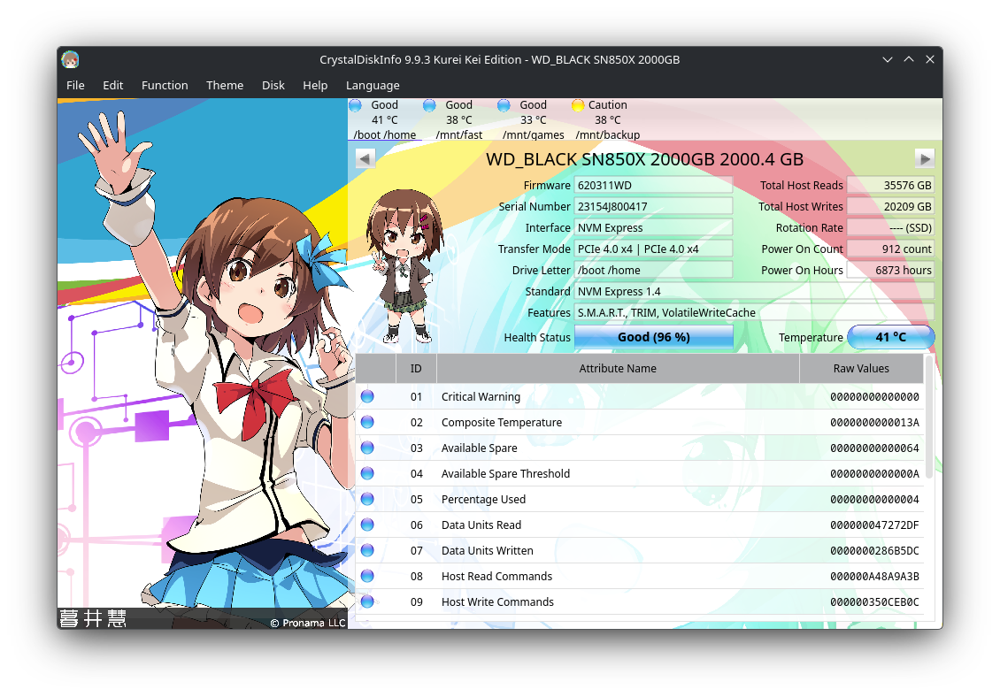
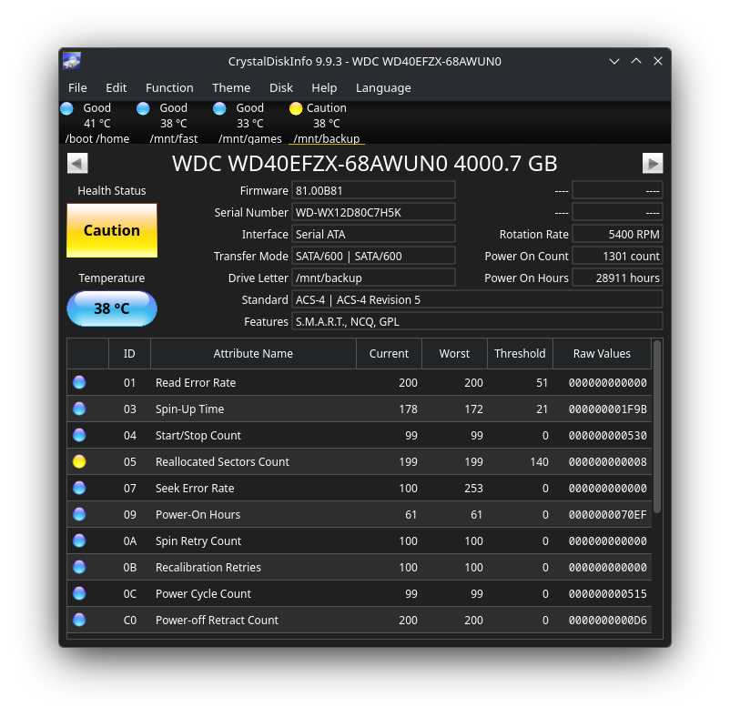

# crystal-disk-info-linux

> [!NOTE]
> This port was written by an LLM (Claude), directed and tested by a human.

An unofficial Linux port of [CrystalDiskInfo](https://crystalmark.info/en/software/crystaldiskinfo/) 9.9.3, including the Shizuku, Kurei Kei and Aoi editions. It is not affiliated with hiyohiyo or Crystal Dew World.

- **The same health verdicts as on Windows.** The original S.M.A.R.T. code (`AtaSmart.cpp`) is compiled unchanged, including its vendor detection for ~50 SSD families, life %, Good/Caution/Bad rules and NVMe interpretation.
- **All editions in one app.** Pick a character theme from the Theme menu and the window switches to that edition's layout, with the character art, the chibi life mascot and her voice when you click her.
- **SATA, NVMe and USB-SATA drives**, read with SG_IO ATA pass-through and the kernel's NVMe admin ioctl. "Drive Letter" shows mount points, including through LUKS and LVM.





<sub>Screenshots use made-up drives, rendered under KDE Plasma with Breeze Dark.</sub>

Nothing from upstream is stored in this repository. The build downloads the official source and edition zips (pinned by SHA-256) from SourceForge. The character art and voices belong to their artists and are only ever fetched from the official release.

## Install (Arch)

```bash
git clone https://github.com/iridium/crystal-disk-info-linux
cd crystal-disk-info-linux
makepkg -si
```

This builds natively, without podman. The package grants the disk helper the capabilities it needs on install, so the app works without root. The edition downloads are about 400 MB, and SourceForge can be slow.

## Build from source

**Dependencies.** To build: CMake, Ninja, a C++17 compiler, Qt 6 (Base and Multimedia), Python 3 with `pefile` and `pillow`, `curl` and `unzip`. To run: just Qt 6 Base and Multimedia.

Arch:

```bash
sudo pacman -S --needed base-devel cmake ninja qt6-base qt6-multimedia python-pefile python-pillow unzip
```

Fedora (untested):

```bash
sudo dnf install gcc-c++ cmake ninja-build qt6-qtbase-devel qt6-qtmultimedia-devel python3-pefile python3-pillow unzip
```

Debian / Ubuntu (untested):

```bash
sudo apt install build-essential cmake ninja-build qt6-base-dev qt6-multimedia-dev python3-pefile python3-pil unzip curl
```

Then:

```bash
./build.sh
./dist/bin/crystaldiskinfo
```

`build.sh` runs these steps, which you can also run by hand:

```bash
linux/tools/fetch_upstream.sh downloads upstream          # download and verify upstream zips
cmake -S linux -B build -G Ninja -DCMAKE_BUILD_TYPE=Release -DCMAKE_INSTALL_PREFIX="$PWD/dist"
ninja -C build && ninja -C build install
linux/tools/assemble_resources.sh downloads upstream dist/share/crystaldiskinfo   # themes, art, voices
```

To build without installing anything on the host, `./build.sh --podman` runs the same steps in an Arch container. Its output links against Arch's Qt, so use it on Arch.

Either way, grant the helper raw disk access once:

```bash
sudo setcap cap_sys_rawio,cap_sys_admin,cap_dac_read_search+ep dist/libexec/crystaldiskinfo/cdi-probe
```

Rebuilding replaces the helper, so run `setcap` again after each build. Without it, the app offers to scan through pkexec instead.

## How it works

- **Upstream logic, Linux I/O.** `linux/tools/extract_core.py` copies upstream `AtaSmart.cpp` and drops only the 97 functions that talk to Windows drivers. `linux/core/` replaces them, and `linux/shim/` stands in for the MFC types (`CString`, `CArray`) the code expects. Upstream is never edited, so a new release should mostly need new checksums.
- **Privilege separation.** Only `cdi-probe` touches the hardware. It captures the raw IDENTIFY, SMART and NVMe log data and prints it as a text snapshot. The GUI runs as your user and interprets the snapshot with the upstream code.
- **Editions follow the theme.** A theme that ships `ShizukuBackground`, `KureiKeiBackground` or `AoiBackground` switches the window to that edition's layout. Voice clips are extracted from each edition's voice DLL at build time.

## Reporting a problem with a drive

Attach a snapshot so the problem can be reproduced without your hardware:

```bash
/usr/libexec/crystaldiskinfo/cdi-probe > snapshot.txt
crystaldiskinfo --snapshot snapshot.txt
```

The snapshot contains your drives' model and serial numbers.

## Not ported

- Tray icon and resident mode
- Graphs
- E-mail and event-log alarms
- AAM/APM control
- Windows-only RAID and USB-NVMe bridge paths. Drives behind these don't appear:
  - Intel RST / VROC
  - AMD RAIDXpert
  - JMicron / ASMedia / Realtek USB-NVMe bridges
  - MegaRAID
  - CSMI

## Credits

CrystalDiskInfo © 2008-2026 hiyohiyo / CrystalMark Inc., MIT License. Shizuku art © kirino kasumu, Kurei Kei © Pronama LLC, Aoi and other themes © their respective artists, all as credited in the official release. This port's own code is under the MIT License (see `LICENSE`).
